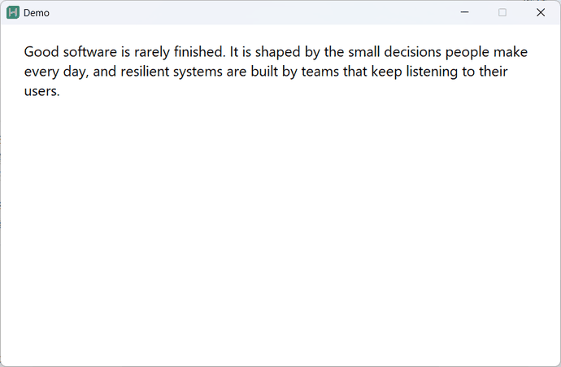
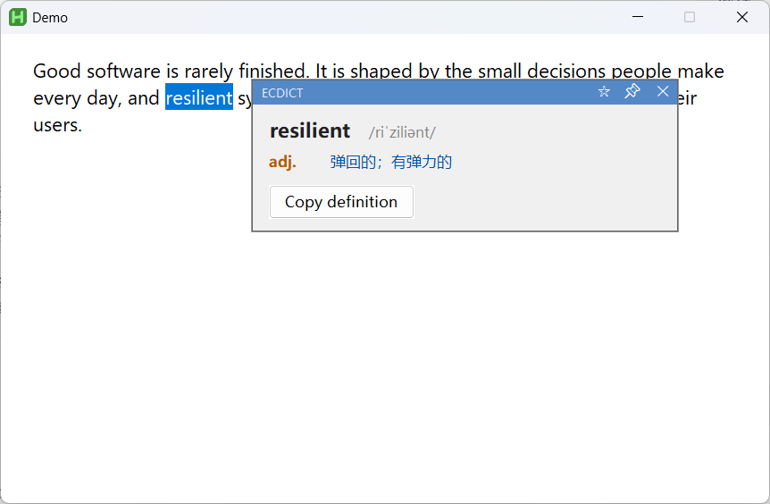
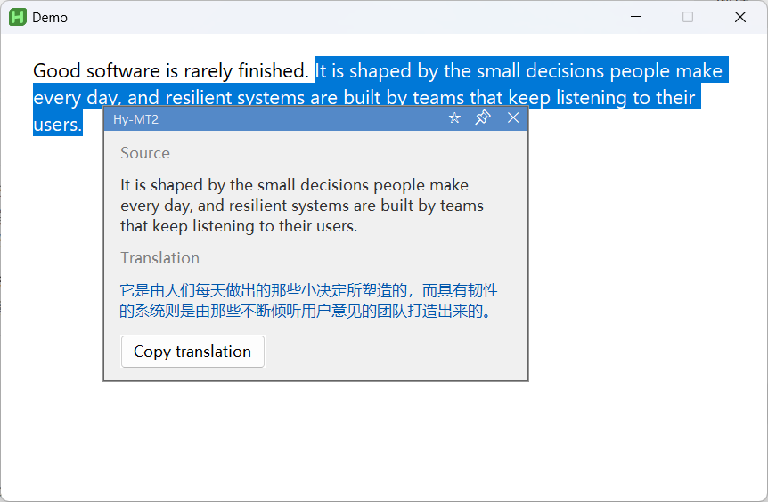
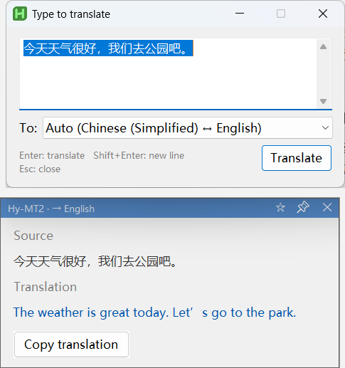
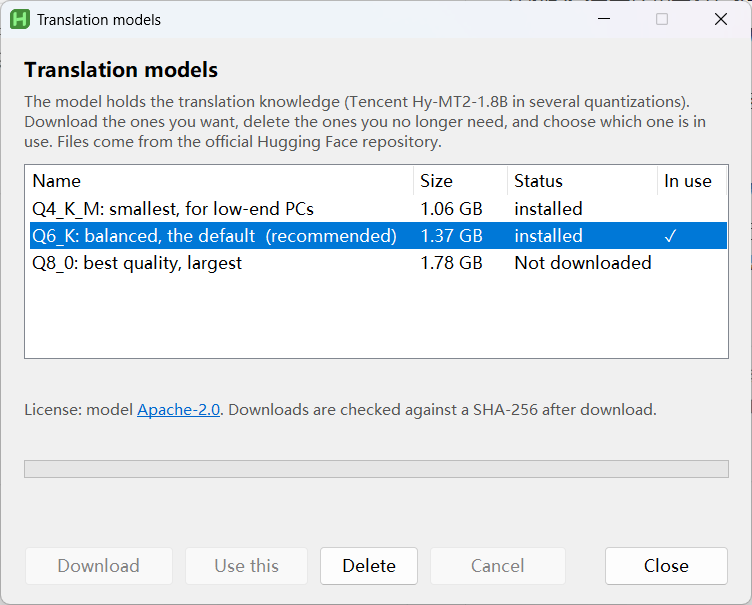
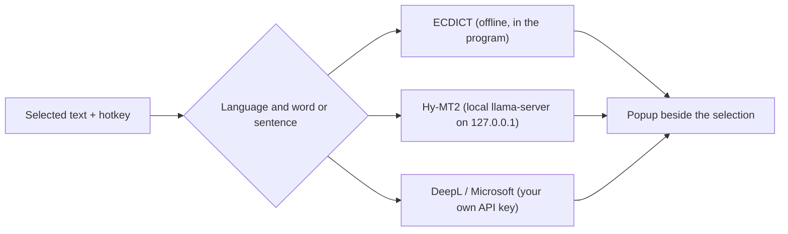

# Selection Translator

**English** | [中文](README.zh-CN.md)

A tiny always-on Windows tray tool: **select English text → press a hotkey (default `Ctrl+Shift+X`) → a side-by-side translation popup appears instantly.** No copy-paste, and the popup never steals focus from what you are doing.



- **Select a word or short phrase** (1–4 English words) → offline **ECDICT** dictionary: phonetics, multiple senses grouped by part of speech, word forms; local lookup in under 1 ms.
- **Select a sentence or paragraph** → a local **Hy-MT2** translation model (Tencent Hy-MT2-1.8B) running on your own machine: no network, no quota.
- **Press the hotkey with nothing selected** → an input box opens: type, press `Enter`, and get a translation. Text goes to your target language; text already in the target language is translated the other way (see *Translation direction*). The **Translate to** list in the box can fix the target language instead; the choice is remembered and only applies to the input box.
- Four engines are available and can be set separately for words and sentences: **ECDICT / Hy-MT2 / Microsoft Translator / DeepL**.

The default setup (ECDICT for words, Hy-MT2 for sentences) needs **no API key and no internet connection** once the model is downloaded.

The interface is available in **English and Chinese** (Settings → General → Language; the default follows your Windows display language). Translations live in plain `lang\*.ini` files, so adding another language is a matter of copying `lang\en.ini`.

## Features

- Popup stays on top, **never takes focus**; click anywhere outside to dismiss it, and that click still reaches the app underneath.
- Draggable title bar, 📌 pin (stay open when clicking outside), ✕ close, one-click copy.
- Select text inside the popup with the mouse and it is copied automatically on release (can be turned off).
- Bookmarks: star a source text from the popup, manage multiple bookmark lists in a window.
- Graphical settings window (tray menu → Settings); changes apply immediately.
- Precise error messages in the popup (missing model, invalid key, region mismatch, quota used up) instead of silent failures.
- **Translation direction** follows Settings: text goes to the target language; text already in the target language goes to the source language if one is set, otherwise to English (to Chinese when the target is English). The language is guessed from the script, plus a small word list for English / French / German / Spanish; kanji-only Japanese is read as Chinese, and a short Latin-script phrase cannot be told apart, so set the source language if the direction is wrong. Pure numbers and URLs are ignored; very long text is truncated (default 5000 characters).
- **Dictionary:** ECDICT only covers English → Chinese, so it is used for English words translated into Chinese; everything else goes to the sentence engine.
- Idle CPU 0%, about 2–5 MB of RAM for the tray process itself (the Hy-MT2 model uses about 2 GB of VRAM only while loaded, and is unloaded after idle).

## Screenshots

| Single word (offline dictionary) | Sentence (local model) |
|---|---|
|  |  |

| Input box | Model manager |
|---|---|
|  |  |

## How it works



Only the online engines send text over the network, and only when you choose them.

## Engines

| Engine | Used for | Result | Requires | Notes |
|---|---|---|---|---|
| **ECDICT** | words (default) | senses + part of speech + phonetics + forms | `dict\` folder (included in the release zip; build it yourself when running from source) | Offline, <1 ms, words and phrases only |
| **Hy-MT2** | sentences (default), words | one translation | llama.cpp runtime and a GGUF model that you download yourself (see below) | Runs locally, ~2 s cold start |
| **Microsoft Translator** *(experimental)* | words, sentences | words: senses + part of speech; sentences: translation | Azure Translator key + region | Online, free tier 2M characters/month |
| **DeepL** | words, sentences | one translation | DeepL API key | Online, free tier 500k characters/month, with regional and sign-up limits (see below) |

> This project **does not distribute** the inference runtime or the model weights. You download them from their official sources. If you only want the dictionary and online APIs, you do not need to download anything.

## Requirements

- Windows 10 / 11
- `Translator.exe` is not code-signed, so Windows SmartScreen may warn on first launch and some antivirus tools flag compiled AutoHotkey programs. Compare the zip with the SHA-256 on the release page, or run `Translator.ahk` from source.
- [AutoHotkey v2](https://www.autohotkey.com/) when running from source (developed on v2.0.26). The compiled release does not need it.
- For the local model, pick one backend:
  - **NVIDIA GPU**: llama.cpp CUDA build; needs a recent driver supporting CUDA 12.4; about 2 GB of VRAM (developed on an RTX 4050 6 GB).
  - **AMD / Intel GPU**: llama.cpp Vulkan build (not tested on the developer's machine).
  - **No dedicated GPU**: llama.cpp CPU build with `gpu_layers=0`; much slower.
- For Microsoft / DeepL: an API key and internet access.

## Install and run

**Compiled release:** unzip and double-click the exe.
**From source:** install AutoHotkey v2, clone the repository, double-click `Translator.ahk`.

A tray icon and a balloon tip appear at the bottom right. A default `config.ini` is created on first run (`config.example.ini` is a fully commented reference).

**First run:** a short setup guide opens once. It asks for your language first, explains the hotkey, and lets you choose how sentences are translated: the local model (it then opens the download window), an online engine, or dictionary only. You can reopen it any time from the tray icon (**Setup guide…**).

1. For online engines: tray → **Settings → Microsoft / DeepL**, click the key-edit button and paste your key. Keys are stored in plain text files next to the program (`secret.txt`, `secret_microsoft.txt`) and are never shown in the UI. Do not share those files.
2. For the local model: follow [Local model setup](#local-model-setup-hy-mt2).

Without a local model, switch the sentence engine to Microsoft or DeepL in the settings. The default word engine, ECDICT, needs nothing.

## Usage

1. Select English text in any program (drag, or double-click a word).
2. Press the hotkey (default `Ctrl+Shift+X`, changeable in Settings).
3. A popup appears: dictionary entry for words, source + translation for sentences. With nothing selected, an input window opens instead.

In the popup: click outside to dismiss; drag the blue title bar to move; 📌 to pin; ✕ to close; ☆ to bookmark the source text; the copy button copies the result.

## Local model setup (Hy-MT2)

**Easiest way:** tray icon → **Settings → Hy-MT2**, where **Inference engine → Manage…** and **Model → Manage…** open two separate windows. Each lists what can be downloaded, what is installed and what is in use: download an entry from the official sources shown below (checked against the pinned SHA-256 in `manifest.json`), choose which one to use (this updates `config.ini` for you), or delete the ones you no longer need. Downloads can be cancelled and resumed. You can keep several engines and models installed and switch between them at any time. It needs the `curl.exe` and `tar.exe` that ship with Windows 10 (1803+) and 11. Files are saved next to the program: engines in `llama\<name>\` (for example `llama\cuda12\`), models in `models\`. An engine you unzip by hand straight into `llama\` is also recognised and can be used, but it is not managed (never deleted) by the program. Not sure which engine to pick? Choose the one marked *Recommended*.

With the Vulkan engine a computer can have several devices that can run the model (for example an NVIDIA card and an Intel iGPU); by default the engine picks one itself. While the Vulkan engine is in use, **Settings → Hy-MT2 → Compute device → Speed test…** appears and translates one sentence on every device the engine can see (plus "CPU only"), shows the speed of each, and can make the fastest one the default (`[Hy] device` in `config.ini`; the field is cleared when you switch engines because device names differ between engines). On some PCs an integrated GPU is slower than the CPU, so it is worth a try if translation feels slow.

**Manual way:** you need two things, both downloaded from their official pages.

**1. The model** — put the `.gguf` file in `models\`. Official repository: [tencent/Hy-MT2-1.8B-GGUF](https://huggingface.co/tencent/Hy-MT2-1.8B-GGUF) on Hugging Face, Apache-2.0 licensed.

| Quantization | Size | Good for |
|---|---|---|
| `Q4_K_M` | 1.13 GB | low-end machines, CPU-only use |
| `Q6_K` (default) | 1.47 GB | balance of quality and speed |
| `Q8_0` | 1.91 GB | plenty of VRAM, best quality |

To use a different quantization, set `model=` in the `[Hy]` section of `config.ini`. Other model families are untested: the prompts and sampling parameters follow the official Hy-MT2 recommendations, so results with other models are not guaranteed.

**2. The inference runtime** — unzip a Windows build from the [llama.cpp releases](https://github.com/ggml-org/llama.cpp/releases) into `llama\` (the archive name contains `cuda`, `vulkan` or `cpu`):

| Your PC | Download | `gpu_layers` |
|---|---|---|
| NVIDIA GPU | the `cuda` build, plus the matching `cudart` package from the same page, unzipped into the same folder | `99` |
| AMD / Intel GPU | the `vulkan` build | `99` |
| No dedicated GPU | the `cpu` build | `0` |

`server=` in `[Hy]` defaults to `llama\llama-server.exe`; change it if you unzipped elsewhere.

The program starts `llama-server.exe` hidden, listening only on `127.0.0.1`, with a random access key generated on each start, and it is killed when the translator exits.

## Microsoft Translator (experimental)

> **Experimental:** this engine has not been verified with a real key. Only the response parsing was tested with the sample data from Microsoft's documentation. Feedback is welcome — please open an issue.

1. Create a **Translator** resource in the [Azure portal](https://portal.azure.com/) (pricing tier F0 is free).
2. On the **Keys and Endpoint** page, copy **Key 1** into `secret_microsoft.txt` (via Settings → Microsoft → edit key) and the **Location/Region** (for example `eastasia`) into the region field. Leave the region empty for Global resources.

Words use the dictionary endpoint (several translations per part of speech); sentences use the translate endpoint. A region that does not match the resource gives a 401 error.

## DeepL

> **Read the limits before choosing DeepL**
> - The free plan allows 500,000 characters per month (see [DeepL's usage limits](https://developers.deepl.com/docs/resources/usage-limits) for the current figure).
> - Signing up for the API requires a payment card issued in a supported country or region. According to third-party sources, cards issued in mainland China cannot be used. Check DeepL's site for whether your region is supported.
> - The free and paid plans handle submitted text differently. Read DeepL's privacy policy and API terms before translating sensitive content.
> - For these reasons DeepL is only an **optional** engine here. The default ECDICT + local model setup needs no key.

1. Register at the [DeepL API page](https://www.deepl.com/pro-api) and choose DeepL API Free.
2. In the account, copy the **Authentication Key**.
3. Tray → **Settings → DeepL → edit API key**, paste it into `secret.txt` (the key only, no quotes or extra lines).

Free keys use `https://api-free.deepl.com/v2/translate`; Pro keys use `https://api.deepl.com/v2/translate` (selectable in Settings).

## Configuration

Most options are in the Settings window. For hand-editing, see the commented [`config.example.ini`](config.example.ini). Notable fields:

| Section | Key | Meaning |
|---|---|---|
| `[Hotkey]` | `trigger` | AutoHotkey syntax: `^` Ctrl, `+` Shift, `!` Alt, `#` Win. Default `^+x`. |
| `[UI]` | `language` | Interface language: `auto` (follow Windows), `zh`, `en`. |
| `[Lang]` | `target_lang` | `ZH`, `EN`, `JA`, `KO`, `FR`, `DE`, `ES`, `RU`. |
| `[Engine]` | `word` / `sentence` | `ecdict`, `hy`, `microsoft`, `deepl` (the sentence engine cannot be `ecdict`). |
| `[Engine]` | `ecdict_fallback` | Engine to switch to when ECDICT has no entry: `none` (default), `hy`, `microsoft`, `deepl`. |
| `[Hy]` | `load_mode` | `idle` (load on demand, unload when idle), `startup`, or `first` (keep loaded after first use). |
| `[Hy]` | `server` / `model` / `port` / `gpu_layers` | llama-server path, model path, local port (default 18080), GPU layers (`99` = all, `0` = CPU). |
| `[Behavior]` | `copy_on_select`, `max_chars`, `network_timeout` | Auto-copy on selection, truncation limit, online request timeout (ms). |

## Build the offline dictionary

The dictionary comes from [ECDICT](https://github.com/skywind3000/ECDICT) (MIT). The release zip includes the converted files. To regenerate them (needs Python 3):

```bash
python tools/build_dict.py path/to/ecdict.csv
```

This produces `dict\ecdict.dat` and `dict\ecdict.idx`. Lookups use binary search on the index and read about 20 lines per query; the dictionary is never loaded into memory.

## Known limitations

- No elevation workaround: windows running as administrator may not expose their selection.
- Popup geometry was verified at 125% display scaling only.
- Chinese→English gives a single translation (ECDICT has no Chinese index).
- The Microsoft engine is experimental (see above).
- The local model has been verified on an NVIDIA GPU (CUDA and Vulkan), an Intel integrated GPU (Vulkan) and the CPU; AMD GPUs have not been tested.
- Bookmarks store source text only; no import/export.
- Only selectable text can be translated (not text inside images).
- The ECDICT data stops around 2017, so very new words may be missing.

## License

This project is released under the [MIT License](LICENSE). Third-party components:

| Component | License | How you get it |
|---|---|---|
| ECDICT dictionary (converted `dict\`) | MIT | included in the release zip |
| Hy-MT2-1.8B (Tencent) | Apache-2.0 | downloaded by you from Hugging Face; not distributed here |
| llama.cpp (and CUDA runtime) | MIT; CUDA runtime under the NVIDIA CUDA EULA | downloaded by you from llama.cpp's official releases; not distributed here |
| AutoHotkey v2 | GPLv2 | install it yourself to run from source; the compiled release embeds its runtime, which is why this project's source is public |

Full license texts are in [`LICENSES\`](LICENSES) and a summary is in [`THIRD_PARTY_NOTICES.txt`](THIRD_PARTY_NOTICES.txt). Keep `LICENSE`, `LICENSES\` and `THIRD_PARTY_NOTICES.txt` when redistributing.

This project is not affiliated with or endorsed by Tencent, NVIDIA, Microsoft, DeepL, the ggml project or the ECDICT author.
