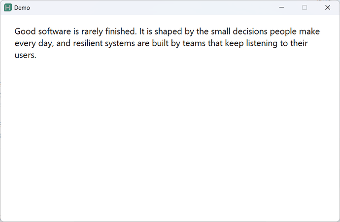
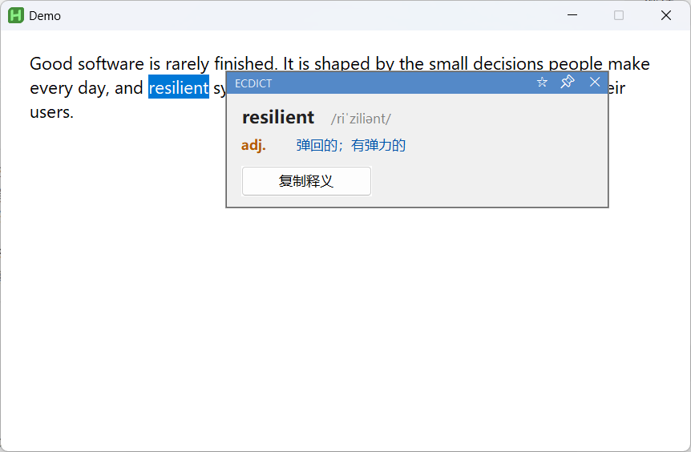
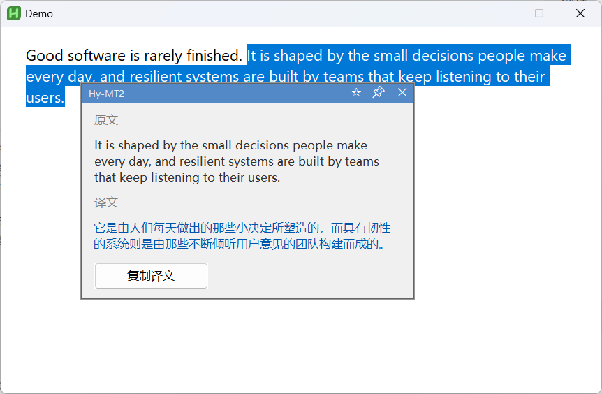
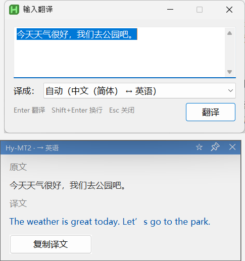
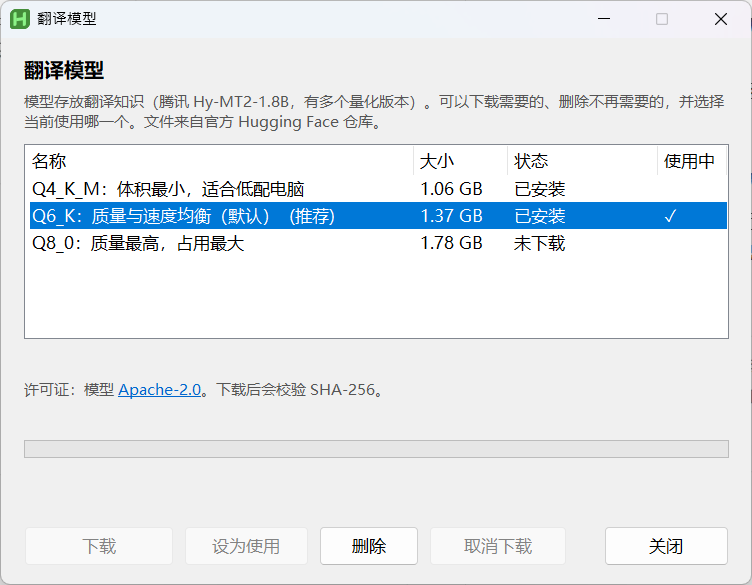
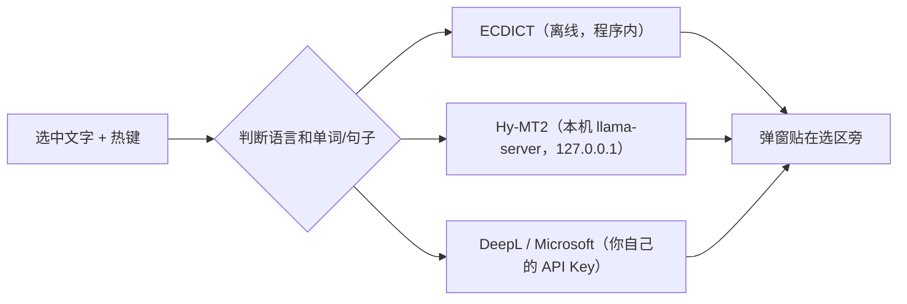

# 选中翻译助手

**中文** | [English](README.md)

极低占用的 Windows 常驻小工具：**选中英文文字 → 按触发热键（默认 `Ctrl+Shift+X`，可在设置里改）→ 即时弹出对照窗**。无需复制粘贴，弹窗不抢焦点、不打扰当前操作。



- **选中单词/短语**（1–4 个英文单词）→ 默认用离线词典 **ECDICT**：音标 + 按词性（`n.` `vt.` `adj.` …）列出多个含义 + 词形变化，本地查询 <1ms
- **选中句子/段落** → 默认用本机显卡运行的 **Hy-MT2** 翻译模型（腾讯 Hy-MT2-1.8B），不联网、无额度
- 单词和句子的引擎都可以在设置或托盘菜单里改成 **ECDICT / Hy-MT2 / Microsoft Translator / DeepL**
- **没有选中文字就按热键** → 弹出输入窗口：打字，`Enter` 翻译；译成目标语言，原文已是目标语言时反向翻译；也可以用窗口里的「译成」下拉框固定目标语言（会记住，只影响输入窗口）

## 截图

| 单词（离线词典） | 句子（本地模型） |
|---|---|
|  |  |

| 输入窗口 | 模型管理 |
|---|---|
|  |  |

## 工作方式



只有在线引擎会把文字发到网络，而且只在你选择它们时才会。

## 功能

- 收藏 / 书签：翻译弹窗标题条上的星星（图钉左边）一点即收藏原文，星星变黄；托盘「书签…」打开书签窗口管理（详见下文「书签（收藏）」）
- 输入翻译：空选区按热键（或托盘「输入翻译…」）弹出输入窗口，`Enter` 翻译、`Shift+Enter` 换行、`Esc` 关闭；自动判断方向（规则见下面的「方向自动判断」），结果贴在窗口正下方，点输入窗口不会关掉结果
- 四种翻译引擎可选（见下表），单词与句子分别设置；弹窗标题条左侧显示本次所用引擎
- **失败显示准确原因**：所选引擎失败时，弹窗直接显示具体原因（如模型文件缺失、Key 无效、区域不匹配、额度用完），便于排查。唯一的自动切换是可选的「**ECDICT 失败时**」：词库里查不到（或词库缺失）时改用你选的引擎（Hy-MT2 / Microsoft / DeepL），弹窗标题标注「自动切换」；默认「不切换」，其它引擎失败一律直接报错
- 单词多义：ECDICT 77 万词条，`ran` 这类变形词自动补上原形 `run` 的释义，`apples` 等自动还原；Microsoft 词典接口同样按词性列出多个译法
- Hy-MT2 本地模型：按需加载、空闲自动卸载（或常驻），翻译一句约 0.2–0.5 秒
- 图形化设置窗口：托盘「设置…」（或双击托盘图标），保存即生效
- 弹窗置顶显示，**不抢焦点**，看完点外部任意处即关闭，点击自动透传到文档
- 顶部标题条可拖动；📌 图钉固定后点外部不关闭；✕ 关闭；「复制译文 / 复制释义」一键复制
- 句子译文、词典的单词 / 音标 / 每行释义 / 词形变化都可以用鼠标划选，松开鼠标自动复制选中的那一段（标题条闪一下「已复制 ✓」；设置里可关）。词性缩写（n. / vt. 这一列）和「原文」区目前不能划选。点弹窗里的其它地方会取消选中；没开自动复制时，选中后鼠标停在弹窗上按 `Ctrl+C` 也能复制（鼠标不在弹窗上时 `Ctrl+C` 照常发给你的程序）
- 选中任何语言都会翻译，方向和输入窗口一致；纯数字 / 网址不弹窗
- 原文/译文自动换行，多行文本完整显示、无滚动条，弹窗随内容自适应高度
- 超长文本自动截断（默认前 5000 字符）并提示
- 空闲 CPU 0%，托盘常驻本身内存 ~2-5MB（Hy-MT2 加载时另占约 2GB 显存）

## 翻译引擎

| 引擎 | 用于 | 结果 | 需要 | 说明 |
|---|---|---|---|---|
| **ECDICT** | 单词（默认） | 多义 + 词性 + 音标 + 词形 | `dict\` 词库（Release 包已附带；从源码运行需自行生成，见「生成离线词库」） | 离线，<1ms，只能查单词/短语 |
| **Hy-MT2** | 句子（默认）、单词 | 一个译文 | 自行下载 llama.cpp 推理程序和模型文件（见「Hy-MT2 本地模型」） | 本机运行，不联网，冷启动约 2 秒 |
| **Microsoft**（实验性） | 单词、句子 | 单词：多义 + 词性；句子：译文 | Azure Translator Key（`secret_microsoft.txt`）+ 区域 | 在线，免费层每月 200 万字符 |
| **DeepL** | 单词、句子 | 一个译文 | DeepL API Key（`secret.txt`） | 在线，免费版每月 50 万字符，有地区与注册限制（见下） |

> 本项目不分发推理程序和模型权重，它们由你从官方渠道下载。只用词典和在线 API 时，可以完全不下载。

## 环境要求

- Windows 10/11
- `Translator.exe` 没有数字签名，首次运行时 Windows SmartScreen 可能提示风险，部分杀毒软件也会误报 AutoHotkey 编译的程序。可以核对 Release 页面上压缩包的 SHA-256，或直接从源码运行 `Translator.ahk`。
- [AutoHotkey v2](https://www.autohotkey.com/)（项目按 v2.0.26 开发）；Release 里的编译版不需要单独安装
- 使用 Hy-MT2（任选一种推理后端）：
  - **NVIDIA 显卡**：llama.cpp 的 CUDA 版，需要支持 CUDA 12.4 的较新驱动；模型约占 2GB 显存（开发机为 RTX 4050 6GB）
  - **AMD / Intel 显卡**：llama.cpp 的 Vulkan 版（未在本项目开发机上实测）
  - **无独立显卡**：llama.cpp 的 CPU 版，`gpu_layers=0`，明显更慢
- 使用 Microsoft / DeepL：对应的 Key 与网络

## 安装 / 运行

**Release 编译版**：解压后双击 exe。

**从源码运行**：安装 AutoHotkey v2，克隆仓库，双击 `Translator.ahk`。

启动后屏幕右下角会有托盘图标与提示气泡。

**首次运行**会弹出一次设置向导：先问界面语言，再介绍快捷键，最后让你选句子的翻译方式（本地模型会接着打开下载窗口 / 在线引擎 / 只用词典）。以后可以从托盘菜单的「设置向导…」重新打开。

1. 首次运行会自动生成带默认值的 `config.ini`（`config.example.ini` 是带完整注释的参考模板）。
2. 只用在线引擎：托盘 **设置… → Microsoft**，点「编辑 Key」粘贴密钥并填区域；或 **设置… → DeepL → 编辑 API Key**。两种 Key 都各自单独存放在程序目录的文本文件里，不在界面显示。
3. 要用本地模型：按「Hy-MT2 本地模型」一节下载推理程序和模型。

没有下载本地模型时，句子引擎不能选 Hy-MT2；请在设置里改用 Microsoft 或 DeepL，单词默认的 ECDICT 不需要任何 Key，也不需要联网。

## 使用

1. 在任意程序里**用鼠标选中一段英文文字**（拖选或双击选词）。
2. 按触发热键（默认 `Ctrl+Shift+X`，可在设置或 `config.ini` 修改，下文以「触发热键」指代）。
3. 弹出对照窗（单词为词典释义，句子为原文 + 译文）。
   **没选中任何文字就按热键** → 改为弹出「输入翻译」窗口（见下节）。
   对照窗上可以：
   - 点**弹窗外**任意处 → 关闭，且该点击正常透传给下方程序（可继续操作）
   - 按住**顶部蓝色标题条**拖动 → 移动窗口
   - 点 **📌** → 固定（图钉变金色），固定后点外部不再关闭；再点一次取消
   - 点 **✕** → 关闭
   - 点 **复制译文** / **复制释义** → 内容进剪贴板

## 输入翻译

没有选中文字时按触发热键（或托盘菜单 **输入翻译…**），弹出一个输入窗口：

| 操作 | 效果 |
|---|---|
| 直接打字 | 输入要翻译的内容 |
| `Enter` | 翻译（输入法组词时的 `Enter` 仍由输入法处理，不会误触发） |
| `Shift+Enter`（或 `Ctrl+Enter`） | 换行 |
| `Esc` / ✕ | 关闭输入窗口（结果弹窗一并关闭，已固定的除外） |

- **方向自动判断**：按设置里的语言决定。原文译成目标语言；原文已是目标语言时反向翻译（弹窗标题条显示 `· → 语言名`），译成设置的源语言，源语言是「自动」时译成英文（目标语言是英文时译成中文）。语言靠文字种类判断，英 / 法 / 德 / 西再用一个小词表区分；只有汉字的日文会被当成中文，很短的拉丁字母短语分不出语言，方向不对时请在设置里指定源语言。
- **词典**：ECDICT 只有英→中，所以只有译成中文的英文单词才查词典，其它情况自动改用句子引擎。
- **引擎**：英文单词/短语用「单词引擎」（默认 ECDICT，显示多义），英文句子用「句子引擎」，中文内容一律用「句子引擎」（词典不能查中文，所以句子引擎不能选 ECDICT）。
- **中文输入没有多词性**：ECDICT 是「英文词条 → 中文释义」的词典，没有中→英的索引，「苹果」这类中文查不到；所以中文（哪怕只有一个词）都走句子引擎，只显示一条译文，不分词性、不列多义。要看中文词的多个英文对应词，目前只能靠 Microsoft 的词典接口（尚未接入中文单词查询，见「已知限制」）。
- 结果沿用现有弹窗，贴在输入窗口正下方；点输入窗口不会关掉它，可以连续输入、连续翻译。翻译后输入框内容会被全选，直接打新词即可替换。
- 输入窗口在前台时再按热键，只是把焦点放回输入框。
- 由于要先尝试复制选区（最多等 0.5 秒）才知道有没有选中文字，空选区按热键后输入窗口会稍有延迟。

## 书签（收藏）

**收藏**：翻译成功的弹窗（词典结果和句子结果）标题条上有一颗星星，在图钉左边。

| 操作 | 效果 |
|---|---|
| 点空心星 ☆ | 把弹窗「原文」区显示的那段文字收藏到**默认书签**，星星变黄色实心 ★ |
| 右键点星星 | 列出所有书签：未收藏 → 收藏到所选书签；已收藏 → 移到所选书签（当前所在的打勾） |
| 点黄色星星 ★ | 弹窗确认后取消收藏 |

- **只收藏原文**，不存译文；需要看译文时在书签窗口里双击这一条，用当前引擎重新翻译（单词走离线词典，句子要用 Hy-MT2 或联网）。
- 单词存的是清理后的词（选中 `Apples,` 会存 `apples`）；超长文本存被截断后的那一段。中→英输入的原文是中文，同样可以收藏。
- 每条原文只属于一个书签；判断「已收藏」只看原文（忽略大小写、首尾空白、连续空白），与引擎无关。已收藏的原文再次翻译时，星星一出现就是黄的。
- 「加载中」和报错的弹窗没有星星。

**书签窗口**（托盘菜单 **书签…**，非模态，可以一直开着）：

- 顶部下拉框切换书签；「新建」「重命名」「删除书签」「设为默认」。默认书签在下拉框里带「（默认）」。
- 内置书签「默认收藏」不能删除、不能改名；可以把任意书签设为默认（星星一键收藏就进默认书签）。删除书签时可选择：内容移到「默认收藏」，或连内容一起删除。
- 列表最新收藏的在最前；搜索框实时过滤当前书签。长句在列表里单行显示，放不下的部分会被截断（没有单独的详情区，双击重新翻译可以看到原文和译文）。
- 每行左侧是多选框，右侧是黄星。点黄星 → 确认后取消收藏。勾选后用底部的「移动到…」（选目标书签，或「新建书签…」）或「删除」批量处理，都要确认；「全选」勾选当前列表里所有条目。
- 双击一条：用当前引擎重新翻译，结果弹在书签窗口右侧，星星已是黄的。
- **确认 / 提示窗口**是统一风格的自绘窗口，不用系统的 Yes/No：顶部色条（删除类红色、其它蓝色）、标题、说明；删除、移动和取消收藏都只写说明，不列出收藏的内容。按钮是中文（如「取消」「删除」「移动」）。删除类的默认按钮是「取消」，`Enter` 也是取消，`Esc` 总是取消。从书签窗口发起时，它**居中在书签窗口上、归它所有（永远盖在上面）**，并锁住书签窗口直到你选完；从翻译弹窗的星星发起时居中在弹窗上。新建 / 重命名书签的名称输入、删除书签的三选一（取消 / 并入默认收藏 / 一并删除）、各种保存失败的错误提示也都是这种窗口，名称不合法时错误直接显示在输入框下面。

**数据**：存在项目目录的 `bookmarks.json`（个人数据，已在 `.gitignore`），每次保存先写 `.tmp` 再替换，并保留上一份 `bookmarks.json.bak`。读到损坏的文件时会改名留存为 `bookmarks.json.corrupt-时间`，提示你，然后从空白书签开始。环境变量 `SELTR_BOOKMARKS` 可以改用别的文件（测试用）。

## 设置窗口

托盘菜单 **设置…**（或双击托盘图标）打开：

| 选项卡 | 内容 |
|---|---|
| 常规 | 触发热键（点输入框直接按组合键录入）、弹出位置、目标/源语言、截断字符数、在线请求超时、复制按钮、系统通知气泡开关、译文划选后自动复制开关 |
| 引擎 | 单词引擎（ECDICT / Hy-MT2 / Microsoft / DeepL）、句子引擎（Hy-MT2 / Microsoft / DeepL） |
| 词典 | 音标、词形变化、专业领域释义（`[医]` `[计]` 等）、最多显示义项数、词库状态 |
| Hy-MT2 | 加载方式（按需加载+空闲卸载 / 随程序启动常驻 / 首次使用后常驻）、空闲卸载分钟数、当前状态、立即加载 / 卸载 |
| Microsoft | 区域（Region）、「编辑 Key」按钮（用记事本打开 `secret_microsoft.txt`） |
| DeepL | 免费版 / Pro 版、「编辑 API Key」按钮（用记事本打开 `secret.txt`） |

点 **保存** 写回 `config.ini` 并立即生效（中文注释保留）。设置窗口打开期间触发热键暂停，以便录入新热键。
含 Win 键的热键设置窗口无法录入，请直接编辑 `config.ini`。

## 托盘菜单

- **输入翻译…**：打开输入翻译窗口（等同于空选区按热键）
- **书签…**：打开书签窗口
- **设置…**：打开设置窗口（双击托盘图标同样打开）
- **单词引擎 / 句子引擎**：子菜单快速切换，当前引擎打勾，点一下立即生效并保存
- **开始/暂停**：暂停后热键不响应（再点恢复）
- **重载配置**：重新读取 config.ini 并重注册热键
- **退出**：结束常驻（同时关闭 Hy-MT2 模型进程）

## Hy-MT2 本地模型

本项目**不分发**推理程序和模型，需要从官方渠道下载。

**最省事的办法**：托盘 → **设置… → Hy-MT2**，里面的「推理引擎 → 管理…」和「模型 → 管理…」会分别打开两个窗口。每个窗口列出可下载的、已安装的和正在使用的：从下面列出的官方来源下载（用 `manifest.json` 里固定的 SHA-256 校验）、选择使用哪一个（会自动写好 `config.ini`），或者删除不再需要的。下载可以随时取消，下次继续。可以同时安装多个引擎和模型，随时切换。需要 Windows 10（1803 以上）/ 11 自带的 `curl.exe` 和 `tar.exe`。文件保存在程序目录里：引擎在 `llama\<名称>\`（例如 `llama\cuda12\`），模型在 `models\`。手动解压到 `llama\` 根目录的引擎也能识别和使用，但程序不会管理（不会删除）它。

用 Vulkan 引擎时，一台电脑可能有多个能跑模型的硬件（例如 NVIDIA 独显和 Intel 集显），默认由引擎自己选。选用 Vulkan 引擎后，**设置 → Hy-MT2 → 运算硬件 → 测速…** 才会出现，它会在引擎能看到的每个硬件（加上「仅 CPU」）上各翻译一句话，显示各自的速度，并可把最快的设为默认（写入 `config.ini` 的 `[Hy] device`；换引擎时会清空，因为不同引擎的设备名不一样）。有些电脑的集显比 CPU 还慢，觉得翻译慢时值得测一下。

**手动下载**：

**1. 模型**（放在程序目录的 `models\`），来自 Hugging Face 官方仓库 [tencent/Hy-MT2-1.8B-GGUF](https://huggingface.co/tencent/Hy-MT2-1.8B-GGUF)，Apache 2.0 许可。可选量化版：

| 量化 | 大小 | 适合 |
|---|---|---|
| `Q4_K_M` | 1.13 GB | 低配电脑、CPU 运行 |
| `Q6_K`（默认） | 1.47 GB | 质量和速度的平衡 |
| `Q8_0` | 1.91 GB | 显存充足、追求质量 |

下载后在 `config.ini` 的 `[Hy] model=` 填文件路径即可换量化版。其他模型未经测试，提示词和采样参数是按 Hy-MT2 官方推荐写的，换别的模型效果无法保证。

**2. 推理程序**（放在程序目录的 `llama\`），从 [llama.cpp Releases](https://github.com/ggml-org/llama.cpp/releases) 下载 Windows 版压缩包解压（压缩包名里带 `cuda`、`vulkan` 或 `cpu`）：

| 你的电脑 | 下载 | `gpu_layers` |
|---|---|---|
| NVIDIA 显卡 | `cuda` 版；同页面还有对应的 `cudart` 运行库包，解压到同一目录 | `99` |
| AMD / Intel 显卡 | `vulkan` 版 | `99` |
| 没有独立显卡 | `cpu` 版 | `0` |

`[Hy] server=` 默认指向 `llama\llama-server.exe`，目录不同时修改它。

- 程序在后台隐藏启动 `llama-server.exe`，只监听 `127.0.0.1`，每次启动随机生成访问密钥（防止网页跨域调用）；翻译助手退出或被强制结束时模型进程一并结束
- 提示词与采样参数按腾讯官方推荐（中文目标用中文提示词，其它语言用英文提示词）
- 失败时弹窗显示原因，例如：找不到 `llama-server.exe` / 模型文件、启动失败（附 `hy_server.log` 里的错误行，如显卡驱动过旧、显存不足）、加载超时
- 没有 NVIDIA 显卡的电脑：下载 Vulkan 版（AMD / Intel 显卡）或 CPU 版并把 `gpu_layers` 设为 `0`（CPU 明显更慢），或把句子引擎换成 Microsoft / DeepL

## Microsoft Translator

> **实验性**：这一引擎的代码未用真实 Key 验证，只用文档里的示例数据测试了结果解析。欢迎试用并通过 Issue 反馈。

1. 在 [Azure 门户](https://portal.azure.com/) 创建 **Translator** 资源（定价层选 F0 免费层）。
2. 打开资源的 **密钥和终结点** 页面：
   - 复制 **密钥 1** → 设置窗口 Microsoft 页点 **编辑 Key（secret_microsoft.txt）**，粘贴到打开的记事本里保存（只放 Key 本身，不要引号、不要多余空行）
   - 复制 **位置/区域**（如 `eastasia`、`southeastasia`）→ 设置窗口的 **区域**；资源位置为 **Global** 时区域留空
3. 保存后在「引擎」页或托盘菜单把单词/句子引擎切换为 Microsoft。

单词走词典接口（`/dictionary/lookup`，按词性列出多个译法；词典里没有的词改用该引擎的普通翻译），句子走翻译接口（`/translate`）。
区域与资源不一致会报 401。Key 和 DeepL 一样单独放在 `secret_microsoft.txt`，不写入 `config.ini`；区域不是机密，保存在 `config.ini` 的 `[Microsoft]` 节。

## 如何申请 DeepL API Key

> **先看限制再决定是否使用**
> - 免费版每月额度为 50 万字符（以 [DeepL 官方说明](https://developers.deepl.com/docs/resources/usage-limits) 为准）。
> - 注册 API 需要所在国家 / 地区受支持的信用卡；据第三方资料，中国大陆发行的信用卡无法开通。你的地区能否使用，请以 DeepL 官网为准。
> - 免费版与付费版对文本的保存和使用条款不同，翻译敏感内容之前请先阅读 DeepL 的隐私政策和 API 条款。
> - 因此 DeepL 在本项目里只是**可选**引擎；不想注册的话，默认的 ECDICT 加本地模型无需任何 Key。

1. 打开 [DeepL API 官网](https://www.deepl.com/pro-api)，注册账号。
2. 选择免费版（DeepL API Free），按页面要求完成验证，进入 DeepL API 控制台。
3. 菜单 **Account → Authentication Key**，复制形如 `xxxxxxxx-xxxx-....` 的 Key。
4. 托盘 **设置… → DeepL → 编辑 API Key**，粘贴到 `secret.txt`（只放 Key 本身，不要引号、不要多余换行）。

## 配置说明（config.ini）

| 节 | 字段 | 说明 |
|---|---|---|
| `[API]` | `api_url` | DeepL 地址：免费版 `https://api-free.deepl.com/v2/translate`；Pro 版 `https://api.deepl.com/v2/translate` |
| `[UI]` | `language` | 界面语言：`auto`（跟随 Windows 显示语言，默认）、`zh`、`en`；设置 → 常规 →「界面语言」 |
| `[Lang]` | `target_lang` | 目标语言：`ZH` 简体中文、`EN` 英文、`JA` 日文、`KO` 韩文、`FR` `DE` `ES` `RU` |
| `[Lang]` | `source_lang` | 源语言，留空 = 自动检测（Microsoft 查单词时按英文处理） |
| `[Hotkey]` | `trigger` | 触发热键，默认 `^+x`（见下文「更换热键」） |
| `[Behavior]` | `window_position` | `cursor` = 贴着选中文字弹出（优先右侧，其次下方、左侧、上方，尽量不盖住选中文字）；`center` = 屏幕中间 |
| `[Engine]` | `ecdict_fallback` | ECDICT 失败（词库里没有该词/词库缺失）时自动改用的引擎：`none`（默认，直接报错）/ `hy` / `microsoft` / `deepl`；设置 → 引擎 →「ECDICT 失败时」 |
| `[Behavior]` | `show_copy_button` | `1` 显示复制按钮 / `0` 隐藏 |
| `[Behavior]` | `copy_on_select` | `1` 在译文里划选后松开鼠标自动复制选中文字（会改写剪贴板）/ `0` 关闭，默认 `1` |
| `[Behavior]` | `show_tray_tips` | `1` 显示系统通知气泡（启动、暂停/恢复、固定、引擎切换、保存/重载设置、翻译失败等）/ `0` 全部关闭，默认 `1` |
| `[Behavior]` | `max_chars` | 超长文本截断上限（字符数），默认 `5000` |
| `[Behavior]` | `network_timeout` | 在线引擎（Microsoft / DeepL）请求超时（毫秒），默认 `10000` |
| `[Engine]` | `word` | 单词引擎：`ecdict`（默认）/ `hy` / `microsoft` / `deepl` |
| `[Engine]` | `sentence` | 句子引擎：`hy`（默认）/ `microsoft` / `deepl` |
| `[Hy]` | `load_mode` | `idle` = 按需加载、空闲卸载（默认）；`startup` = 随程序启动常驻；`first` = 首次使用后常驻 |
| `[Hy]` | `idle_minutes` | `idle` 模式下空闲多少分钟卸载，默认 `10` |
| `[Hy]` | `server` / `model` | llama-server 与模型路径（相对项目目录或绝对路径） |
| `[Hy]` | `port` | 本机端口，默认 `18080`，与其它程序冲突时修改 |
| `[Hy]` | `gpu_layers` | 放到显卡的层数，`99` = 全部；`0` = 纯 CPU |
| `[Microsoft]` | `region` | Azure Translator 资源的区域（如 `eastasia`，Global 资源留空）；密钥不在这里，见 `secret_microsoft.txt` |
| `[Dict]` | `show_phonetic` | `1` 显示音标 |
| `[Dict]` | `show_forms` | `1` 显示词形变化（复数、过去式、比较级等） |
| `[Dict]` | `show_domain` | `1` 显示 `[医]` `[计]` `[网络]` 等领域释义；默认 `0`（词条只有领域释义时仍显示） |
| `[Dict]` | `max_senses` | 最多显示几行义项，`0` = 全部 |

> API Key 都不在 `config.ini`：DeepL Key 在 `secret.txt`，Microsoft Key 在 `secret_microsoft.txt`（各自只放 Key 本身）。

## 生成离线词库

词库来自开源项目 [ECDICT](https://github.com/skywind3000/ECDICT)（MIT 许可）。项目已附带生成好的 `dict\` 文件；如需重新生成（例如 ECDICT 更新）：

1. 下载 [`ecdict.csv`](https://raw.githubusercontent.com/skywind3000/ECDICT/master/ecdict.csv)（约 63MB）。
2. 运行（需要 Python 3）：

   ```bash
   python tools/build_dict.py path/to/ecdict.csv
   ```

   生成 `dict\ecdict.dat`（按单词排序的词条）与 `dict\ecdict.idx`（偏移索引）。脚本会把旧式词性 `a.` 统一为 `adj.`、音标重音符换成 IPA `ˈ` `ˌ`。

查询时在索引上二分查找、每次只读约 20 行，**词库不载入内存**，常驻占用不变。

## 更换触发热键

在设置窗口「常规」页直接录入；或编辑 `config.ini` 的 `trigger` 字段。写法：

| 符号 | 含义 |
|---|---|
| `^` | Ctrl |
| `+` | Shift |
| `!` | Alt |
| `#` | Win |

例：`^+x` = Ctrl+Shift+X；`!+z` = Alt+Shift+Z。手动改完在托盘菜单点 **重载配置** 立即生效，无需重启。

## 已知限制

- 不做管理员权限兜底，以管理员运行的高权限窗口可能取不到选中内容
- 暂不支持开机自启（预留可选项）
- 弹窗位置/几何在 125% 缩放下验证，其它 DPI 未逐一验证
- 输入翻译窗口的 `Enter` 未用真实输入法实测（依赖 Windows 默认按钮机制，输入法组词期间的 `Enter` 由输入法消化）；请用拼音输入法试一下
- 中文→英文只有单条译文，不显示词性和多个义项（ECDICT 无中→英索引；Microsoft 词典接口支持 zh→en，但尚未接入，也未用真实 Key 测试）
- 书签只收藏原文；两个引擎对同一个词的译文不同也算同一条。书签窗口大小固定，不记忆位置；不支持导出/导入
- 连点星星太快会被系统当成双击而忽略
- 仅翻译选中文字；图片、PDF 内文字需要可选中为文本才有效
- 词典不结合上下文：一词多义时列出全部义项，由你自行判断；ECDICT 约 2017 年后的新词/俚语可能查不到（可把单词引擎换成 Hy-MT2 或 Microsoft）
- Microsoft 引擎为实验性：代码未用真实 Key 实测（开发时无 Key），仅用文档示例数据测试了结果解析，欢迎反馈
- 本地模型已在 NVIDIA 显卡（CUDA 和 Vulkan）、Intel 集显（Vulkan）和 CPU 上实测；AMD 显卡未测试
- Hy-MT2 翻译在后台线程同步执行，一句通常 <0.5 秒；超长文本（数千字符）会更久，期间再按热键会被忽略

## 项目结构

```
Translator.ahk   主程序（双击运行）：热键、取词、弹窗、托盘
InputWin.ahk     输入翻译窗口（空选区按热键弹出）
Dialogs.ahk      统一风格的确认 / 提示 / 输入窗口（取代系统 MsgBox / InputBox）
Bookmarks.ahk    书签数据层（bookmarks.json 读写、增删移动、损坏处理）
BookmarkWin.ahk  书签窗口（托盘「书签…」）
Engines.ahk      引擎调度 + HTTP + DeepL + Microsoft
HyMT.ahk         Hy-MT2：llama-server 启动/健康检查/空闲卸载/翻译
Dict.ahk         ECDICT 离线词典查询
Json.ahk         JSON 解析/生成
SpeedTest.ahk    「测速并选择运算硬件」窗口（设置 → Hy-MT2 → 测速…）
Models.ahk       本地模型管理：manifest 读取、硬件检测与推荐、安装状态
Download.ahk     下载器：curl 断点续传 + SHA-256 校验 + 解压（不阻塞界面）
ModelWin.ahk     「推理引擎」和「翻译模型」两个管理窗口（设置 → Hy-MT2 → 管理…）
manifest.json    可下载内容清单：固定版本的下载地址、大小、SHA-256、许可证
I18n.ahk         界面多语言：Tr("key") 取当前语言的文字
lang\            语言文件 zh.ini / en.ini（新增语言：复制 en.ini 翻译；改完运行 python tools/check_i18n.py）
Wizard.ahk       首次启动向导（语言 → 用法 → 句子翻译方式 → 完成）
Settings.ahk     设置窗口 + config.ini 写回
config.ini       配置文件（不含任何 Key）
secret.txt       DeepL API Key（用户自行填写，不进 git）
secret_microsoft.txt  Microsoft Translator Key（用户自行填写，不进 git；缺失时首次点「编辑 Key」自动创建）
dict\            离线词库 ecdict.dat / ecdict.idx（tools\build_dict.py 生成，不进 git，Release 包附带）
llama\           llama.cpp 推理程序（用户自行下载，不进 git）
models\          GGUF 模型文件（用户自行下载，不进 git）
bookmarks.json   书签数据（个人数据，不进 git；自动生成）
hy_server.log    llama-server 运行日志（每次启动覆盖）
tools\           build_dict.py：ECDICT CSV → 离线词库；check_i18n.py：检查两种语言文件是否对齐
e2e.ahk          端到端回归测试（下详）
README.md        英文说明
README.zh-CN.md  本说明（中文）
LICENSE          本项目许可证（MIT）
```

## 端到端回归测试（e2e.ahk）

用真实操作为应用做回归：自动开记事本 → `Ctrl+A` + 触发热键（测试脚本内使用默认的 `Ctrl+Shift+X`）→ 对弹窗做断言。使用默认引擎（单词 ECDICT、句子 Hy-MT2），不需要任何 Key。场景：

| 场景 | 断言 |
|---|---|
| S1 | 弹窗出现后前台仍为记事本（不抢焦点） |
| S2 | 点弹窗外部 → 关闭，且该点击透传给文档 |
| S3 | 点 📌 固定 → 点外部不关闭；点 ✕ → 关闭 |
| S4 | 拖标题条 → 弹窗移动 |
| S5 | 点「复制译文」→ 剪贴板有译文 |
| S6 | 临时改 `center` 位置模式 → 弹窗居中 |
| S7 | 临时把 Hy-MT2 模型路径改错 → 弹窗显示「找不到 Hy-MT2 模型文件」，不崩溃 |
| S8 | 还原配置 → 恢复正常翻译 |
| S9 | 点弹窗底边（矩形内）→ 不关闭（防 DPI 误关） |
| S10 | 多行原文完整显示（换行不丢）；无滚动条（无 Edit 控件） |
| S11 | 单词 `fine` → 词典弹窗，含 `adj.` `vt.` 等词性与多个义项 |

运行：双击 `e2e.ahk`，约 80 秒，逐条打印 `OK`/`(BUG)` 到 `%TEMP%\seltr_e2e.log`。测试使用自己的临时设置文件（环境变量 `SELTR_CONFIG`），**不会碰你的 config.ini**；
运行期间请勿操作鼠标键盘——如果记事本不在前台，脚本会立刻中止而不是把按键发给别的窗口。S6 需要 1920 物理宽度以上的主屏。

## 第三方组件与许可

本项目自身使用 [MIT 许可证](LICENSE)。使用到的第三方组件如下，许可证全文见 [`LICENSES\`](LICENSES)，汇总声明见 [`THIRD_PARTY_NOTICES.txt`](THIRD_PARTY_NOTICES.txt)：

| 组件 | 许可证 | 如何获得 |
|---|---|---|
| ECDICT 词库（转换后的 `dict\`） | MIT | 随 Release 包分发 |
| Hy-MT2-1.8B（腾讯） | Apache 2.0 | 用户自行从 Hugging Face 下载，不随本项目分发 |
| llama.cpp（含 CUDA 运行库） | MIT；CUDA 运行库遵循 NVIDIA CUDA EULA | 用户自行从 llama.cpp 官方下载，不随本项目分发 |
| AutoHotkey v2 | GPLv2 | 源码运行需自行安装；Release 编译版内嵌其运行时，因此本项目源码一并公开 |

再分发本项目时，请保留 `LICENSE`、`LICENSES\` 与 `THIRD_PARTY_NOTICES.txt`。
